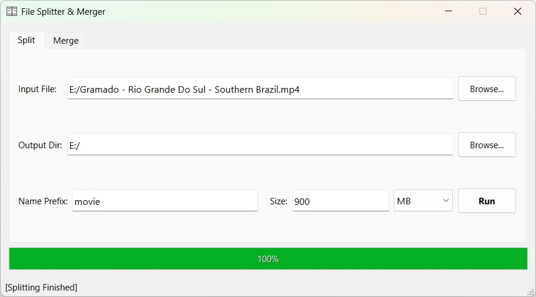
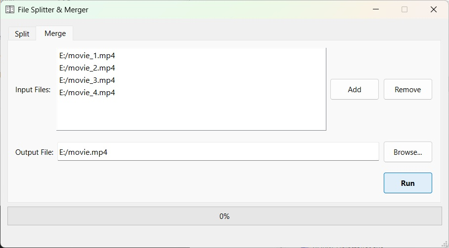

# QtLargeFileSplitMerge

This is a Qt-based application designed for splitting large files into smaller chunks and merging multiple files into one. The application provides an intuitive graphical interface for users to easily manage file splitting and merging tasks.

## Features

- **File Splitting**: Split large files into smaller chunks based on user-defined chunk sizes.
- **File Merging**: Merge multiple files into a single file in the order specified by the user.
- **Progress Tracking**: Real-time progress updates during file operations.
- **Multi-file Selection**: Supports adding multiple files for merging.
- **Customizable Output**: Allows users to specify output directory, file naming patterns, and output file paths.
- **High-Reliability Large File I/O (GigaBytes/TeraBytes-Scale Optimized)**:
  - **Contiguous Disk Preallocation**: Preallocates target file blocks prior to writing to minimize filesystem fragmentation and mechanical hard drive (HDD) head thrashing.
  - **Periodic Hardware Flushing & Cache Eviction**: Forces OS dirty pages and drive controller caches to sync to physical platters every 64 MB, preventing multi-gigabyte RAM cache buildup and SMR drive stalls.
  - **End-to-End Physical Disk Verification**: Computes a streaming SHA-256 hash during read/write operations and performs a post-write read-back verification bypassing the OS RAM page cache to detect silent data corruption on physical storage media.
  - **Atomic Rollback on Failure or Abort**: Automatically cleans up incomplete or corrupted output files if an I/O error, verification mismatch, or user cancellation occurs.

## Screenshots

## Getting Started

### Prerequisites for Building

- Qt 5.x or higher
- C++11 compatible compiler

### Usage

1. **Splitting a File**:
    - Open the application.
    - Go to the `Split` tab.
    - Click `Browse...` next to the `Input File` field to select the file you want to split.
    - Click `Browse...` next to the `Output Dir` field to select the directory where the chunks will be saved.
    - Optionally, specify a name prefix and chunk size.
    - Click `Run` to start splitting the file.

2. **Merging Files**:
    - Open the application.
    - Go to the `Merge` tab.
    - Click `Add` to select the files you want to merge. The selected files will appear in the list.
    - Use `Remove` to remove any files from the list.
    - Click `Browse...` next to the `Output File` field to specify the path for the merged file.
    - Click `Run` to start merging the files.
